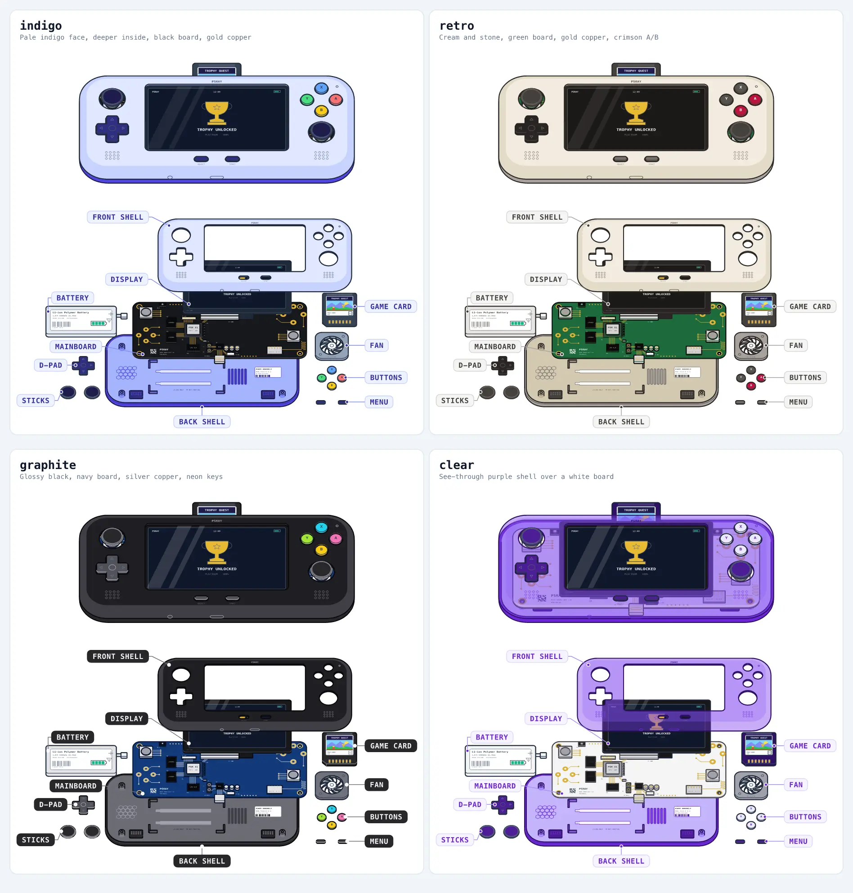

# Home page

The home page is the hero card, and below it the hub: the site's way in, for crawlers too.

- **Left:** an animated teardown of a handheld game console. It loops: the console comes apart, its parts lie labelled on the table, and it goes back together.
- **Right:** the title, a short lead and the PSN ID lookup. They animate in once on arrival.

Both sides share a colour scheme, picked at random per page load from four.

Below the hero, `app/components/home/Hub.vue` lists trending and newly added trophy sets and the top
of the points board, each with a link to its full list. These are server-rendered links, so a crawler
that lands on the homepage can reach the rest of the site (see `docs/seo.md`). A section whose request
fails or comes back empty is left out; the page still answers 200. It shows no times, so nothing
relative can drift between the server render and hydration.



## Files

| File | What it does |
| --- | --- |
| `app/pages/index.vue` | The card: layout, copy, lookup form, and the copy's animations (timings live here) |
| `app/components/home/Hub.vue` | The hub below the card: trending and new trophy sets, top players |
| `app/components/home/Teardown.vue` | Loads the drawing, runs the loop, draws the callouts |
| `app/composables/useTeardownPalette.ts` | Picks the colour scheme; shared by the drawing and the copy |
| `app/utils/teardownMotion.ts` | The choreography: where every part is at any moment, and in what paint order |
| `app/assets/css/main.css` | Keyframes and classes for the copy's animations (`hero-*`) |
| `app/assets/teardown/*` | **Generated.** The drawing, its motion data, its placeholder; don't edit |
| `scripts/generate-teardown.mjs` | Builds `app/assets/teardown/` from the model; colour schemes and callouts are defined here |
| `tools/teardown/handheld/model.js` | The console's 3D model and everything printed on it |
| `tools/teardown/` | The vendored teardown skill (renderer); see its README |

## Layout

- **Container query.** The card is a size container. From `@3xl` (48rem of card width), it has two columns: `19fr` (drawing, about 47.5%) and `21fr` (copy), 32 px apart. Narrower, the drawing sits above the copy.
- **No fixed height.** The card fits its taller column, usually the copy. Both columns are centred vertically.
- **Buttons.** The copy column is its own container. Its buttons sit side by side from `@sm` (24rem) and stack below that. The order is "Sync" then "View profile": the primary action is on the right, and the DOM follows the visual order so Tab does too. Enter in the field opens the profile, because Sync is `type="button"`.
- **Field spacing.** The field sits 16 px under the lead and 20 px above the buttons. The lead's line height leaves about 5 px under its last line, so the two gaps look equal.
- **Lead size.** The lead is 14 px on phones and 15 px from `sm`.

## The drawing

### How it is made

`tools/teardown/handheld/model.js` models a concept console. Every dimension and marking is invented; `tools/teardown/handheld/evidence.md` says what is borrowed from the category and what isn't.

Re-run this after changing the model, the layout, the callouts or the colours, and commit what it writes:

```sh
pnpm generate:teardown
```

The generator renders each part on its own with the skill's hidden-line renderer and writes:

- `handheld.svg`: about 160 KB, about 24 KB brotli. It holds every part and every colour scheme.
- `handheld.json`: where parts go and when, the callouts, and the colours the page needs.
- `handheld-placeholder.svg`: about 2 KB. It is the assembled silhouette.

### Loading

- SSR inlines the placeholder silhouette.
- After hydration, the component fetches the drawing (a hashed URL, so it is cached) and fades it in at the same place. Nothing shifts.
- The fetch is shared across mounts within a page load.

### The loop

One cycle takes 17.6 s:

1. The console comes apart from the top of the stack down (about 4.7 s).
2. The parts rest laid out (4.6 s).
3. They go back from the bottom up.
4. The console rests assembled (2.4 s).

The first view holds the assembled console 0.9 s before starting.

- **Camera.** While assembled, the view is a close-up (`CLOSE_UP`). It pulls back to the whole spread as the parts leave.
- **Moving the parts.** Every part is a layer moved by a transform. `teardownMotion.ts` says where each one is and which paints on top. The generator's proofs use the same module, so the two never disagree.
- **Pausing.** Time runs only while the drawing is at least 25% on screen and the tab is visible. It resumes where it stopped.
- **Reduced motion.** With `prefers-reduced-motion`, the page shows the spread, with its callouts, and nothing moves.

### Callouts

Each part on the table has a tag: a dot on the part, a leader, and its name. The tags stay in English in every locale.

- **Defining them.** They are defined in `LABELS` in the generator. Each entry gives the name and a point on the part (model millimetres, assembled). Then:
  - An offset in drawing units places the tag freely.
  - `'column'` lines it up with the others on the right.
  - `'below'` hangs it under its part.
- **Drawing.** The page draws the leaders in SVG and the tags in HTML, coloured by the scheme.
- **When they show.** Tags show only while the view holds still on the spread.
- **Size.**
  - Tags are designed at 8 px for a `PAGE_WIDTH` of 450 px, the desktop column.
  - The page scales them with the drawing, clamped to 6–10 px.
  - On a phone the 6 px floor makes them relatively larger. `TAG_ROOM` (1.25×) is the room the layout keeps for that.
  - The generator throws if any two tags would overlap at that size.
  - If you make the column narrower or the floor larger, raise `TAG_ROOM` to match: 6 px divided by the tag size at the smallest drawing width (278 px, on a 360 px phone).

### Where to change what

| To change | Edit |
| --- | --- |
| Where parts rest laid out | `SPREAD` (world offsets; parts may overlap, and heights stack automatically) |
| When parts move, how high, how long things hold | `MOVES`, `FLIGHT`, `SLIDE`, `LIFT`, `HOLD_APART`, `HOLD_TOGETHER` |
| Paint order rules | `app/utils/teardownMotion.ts` |
| How big the assembled console is | `CLOSE_UP` (share of the drawing's width) |
| Callout names, anchors, positions | `LABELS` |
| Tag size | `TAG`, `PAGE_WIDTH`, then check `TAG_ROOM` |
| A part's shape, or what's printed on it | `tools/teardown/handheld/model.js` |
| Colours | `PALETTES` (next section) |
| Column widths | the grid in `index.vue`. Then update `PAGE_WIDTH` to the drawing's new desktop width, so the tag sizes stay the same. |

## Colour schemes

`PALETTES` in the generator holds four schemes: `indigo`, `retro`, `graphite` and `clear`. Each has:

- `body`: the fill colour of each part.
- `colours`: tones for flat regions such as faces, chips, the screen and labels.
- `inks`: line and text colours.
- `parts`: per-part ink overrides.
- `fade`: makes something see-through, such as the clear shell.
- `page`: the colours the page uses next to the drawing:
  - the callout tags: `bg`, `fg`, `ring` and `line`
  - three highlighters for the lead, `marks`, one `[band, text]` pair per phrase
- `title`: a one-line description, used by the sheet above.

How the schemes are applied and picked:

- **One file.** All four ship in the one SVG, each scoped to `[data-palette=<name>]` on the `<svg>`. The three extra schemes cost under 1 KB brotli.
- **Picking.** `useTeardownPalette()` picks once per page load:
  - at random, but never the scheme shown last (stored in `localStorage` under `psray:teardown-palette`)
  - it holds while navigating within the site, and a reload picks again
- **Before the pick.** Until the pick, during SSR, the first scheme applies.
- **Adding a scheme.** Add an entry to `PALETTES`, with its `page` colours and three marks. Run `pnpm generate:teardown`, then regenerate the sheet (see [Checking a change](#checking-a-change)). It joins the rotation by itself.

## The copy

### Arrival (once)

| What | When | Defined in |
| --- | --- | --- |
| Logo fades in, then wiggles | 0, wiggle at 450 ms | `.animate-hero-logo` |
| Title letters rise out of a blur, left to right | 80 ms + 35 ms per character | `.hero-letter`, `ENTER_STEP` |
| Lead revealed top to bottom behind a soft edge | 350 ms, over 1.1 s | `.animate-hero-reveal` |
| Form, then hint, rise out of a blur | 750 ms, 900 ms | inline `animation-delay` |
| Highlighters sweep over three phrases; each phrase takes its ink | 1200, 1550, 1900 ms after mount | `MARKS` |
| A ring pulses out of the field | 2400 ms after mount | `.is-marked .hero-ring` |
| The title's letters hop once, left to right | 2600 ms after mount | `SWEPT`, `hop()` |

Times without "after mount" count from first paint. Those steps are pure CSS and need no JavaScript.

The highlighters and the ring wait for the colour scheme, which is picked on mount. The page then adds `.is-marked`, and `.is-swept` once the sweeps are done.

### Hover

- **A highlighted phrase:** its highlighter fills from the bottom up (0.3 s).
- **The title:** a hop runs along it, 30 ms per character, 0.5 s per hop, once per hover. It finishes even if the pointer leaves.
- **Timing:** neither works before the arrival is over.

With `prefers-reduced-motion`, nothing moves and the highlighters are simply there.

### Things to know before changing it

- **Delays.** Delay `animate-hero-in` with an inline `animation-delay`. Its `animation` shorthand resets the delay from a Tailwind `[animation-delay:…]` class.
- **The entrance can't replay.** After `.is-swept`, the title letters drop their entrance animation. Otherwise ending a hop would replay it.
- **Splitting the title.** The title is split by a plain regex, not `Intl.Segmenter`, so the server and the browser split it alike. CJK splits into characters. Other scripts split into letters grouped by word, so lines still break only between words.
- **Accessibility.** The `<h1>` carries the title as its `aria-label`; the letters are `aria-hidden`.

## Copy and translations

| Key | Use |
| --- | --- |
| `home.hero.title` | The title. Any language works with the letter animation. |
| `home.hero.lead` | The lead, with `{progress}`, `{psnId}` and `{glance}` where the highlighted phrases go |
| `home.hero.marks.progress` / `.psnId` / `.glance` | The highlighted phrases, in that order: first, second and third highlighter |
| `home.teardown.label` | The drawing's accessible name |
| `home.lookup.*` | Field, buttons, hint |

The lead is rendered with `<i18n-t keypath="home.hero.lead" scope="global">`. When translating it:

- Keep all three placeholders.
- Write the sentence so it reads with each phrase dropped in. Particles stay outside the phrase, as in Korean `{progress}을`.
- To highlight a different phrase, change the `marks` entry, not the lead.

`pnpm check:locales` checks that every locale has every key.

## Checking a change

The generator stops with an error when two callout tags would overlap at their largest, or when the timeline disagrees with `teardownMotion.ts`.

```sh
pnpm generate:teardown

# Stills as the page shows them, at 2× the desktop column:
# still00000-<scheme>.png is assembled, still08500-<scheme>.png is laid out.
PROOF_WIDTH=900 node scripts/generate-teardown.mjs --proof /tmp/stills --moments 0,8500 --still

# The same, outlining the room each tag needs on a phone
TAG_ROOM=1 PROOF_WIDTH=900 node scripts/generate-teardown.mjs --proof /tmp/stills --moments 8500 --still

# The palette sheet in this doc; then convert it to WebP (quality ~75, any encoder) as docs/images/home-palettes.webp
PROOF_WIDTH=900 node scripts/generate-teardown.mjs --sheet /tmp/home-palettes.png
cwebp -q 75 /tmp/home-palettes.png -o docs/images/home-palettes.webp

pnpm test && npx nuxi typecheck && pnpm check:locales
```

The stills come from resvg, which ignores `vector-effect`. The generator converts line widths to drawing units for them, so a still matches the page's line weights.

In a browser, look at:

- the desktop width and a 360 px phone
- one full loop, to see the loop and callouts
- a reload, which should bring a different scheme
- hovering the title and a highlighted phrase
- the page with reduced motion turned on

`tools/teardown/README.md` covers the model and the renderer in more depth, including the skill's interactive viewer.
